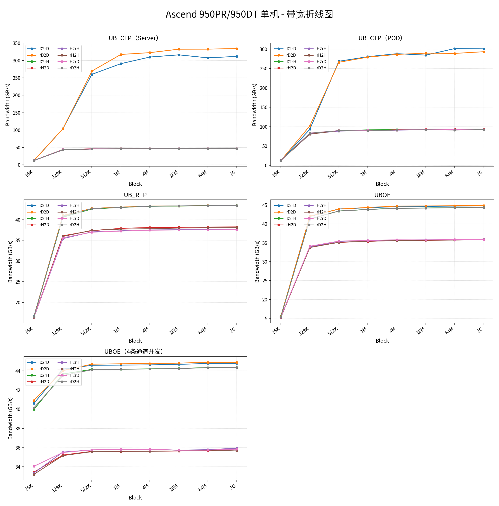
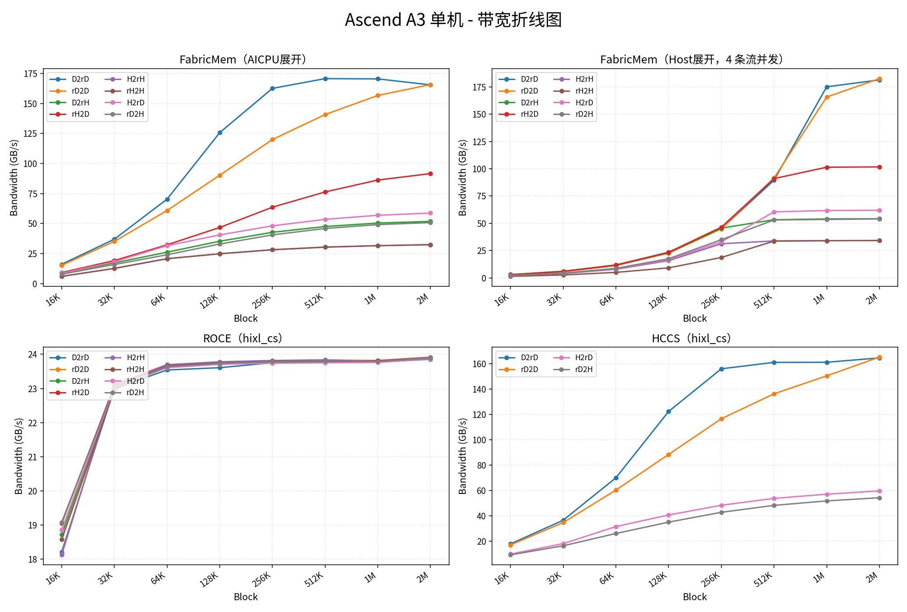
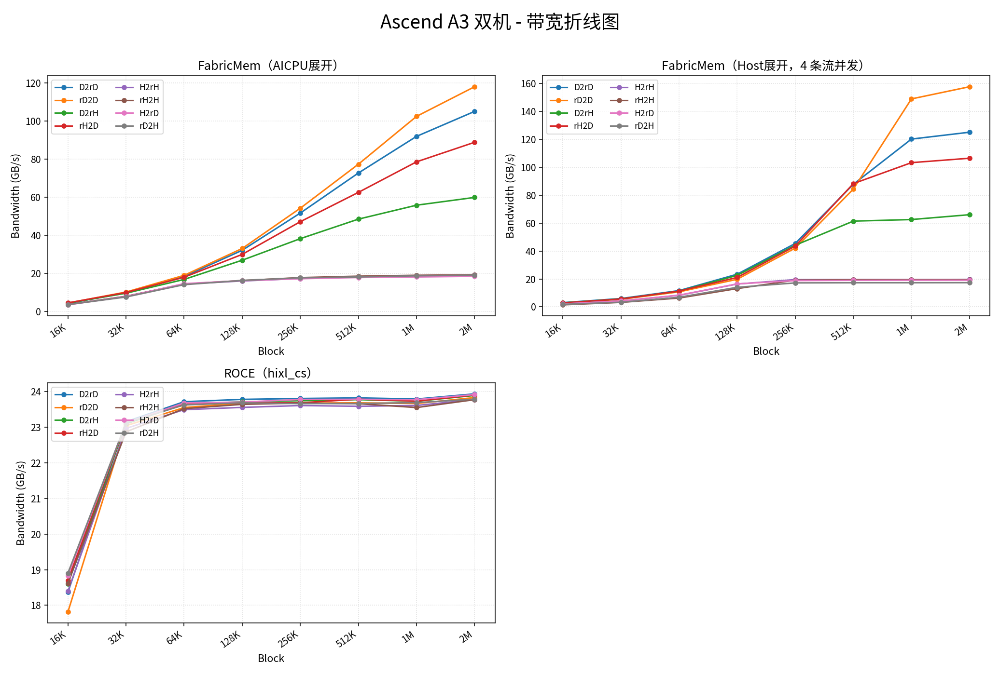
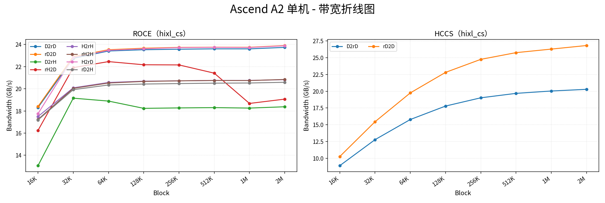
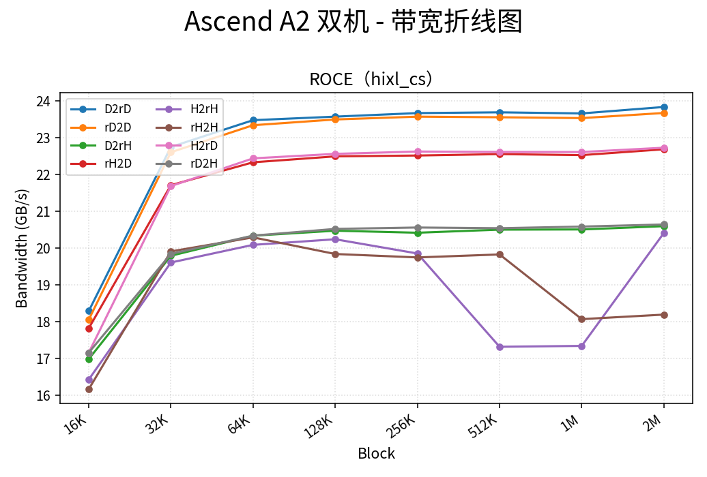

# HIXL 通信性能数据

本文档汇总 HIXL 在不同昇腾平台上的通信性能数据，按平台分章节。

> **说明**：NPU 访问 Host 内存时，若该内存与 NPU 不在同一 Host 芯片/NUMA 节点，需经片间互联转发，引入额外时延，带宽随之下降。若 NPU 拓扑存在亲和性差异且测试场景涉及 Host 内存，应设置 CPU 亲和性，使 Host 内存分配在 NPU 亲和的本地 NUMA 节点，以避免该损失。如需测出极致性能，请参考 [Host亲和性设置说明](https://gitcode.com/cann/hixl/wiki/Host%E4%BA%B2%E5%92%8C%E6%80%A7%E8%AE%BE%E7%BD%AE%E8%AF%B4%E6%98%8E.md)。

---

## HIXL在Ascend 950PR/Ascend 950DT上部分场景实测性能数据

### 如何读懂表格

- **Block**列：每个数据块大小（16K = 16KiB，1G = 1GiB），从16K到1G共8档。
- 各传输协议分表展示，顺序为**UB_CTP** → **UB_RTP** → **UBOE**；列按方向排列：`D2rD`、`rD2D`、`D2rH`、`rH2D`、`H2rH`、`rH2H`、`H2rD`、`rD2H`。
- **UB_CTP**按测试环境区分：**Server**在前，**POD**在后。
- **UBOE**再按通道数区分：默认单通道在前，**4条通道并发**在后。
- 数值为有效带宽（GB/s）。

### 单机数据

#### UB_CTP（Server）

| **Block** | **D2rD** | **rD2D** | **D2rH** | **rH2D** | **H2rH** | **rH2H** | **H2rD** | **rD2H** |
| :---: | :---: | :---: | :---: | :---: | :---: | :---: | :---: | :---: |
| 16K | 12.384 | 12.651 | 12.61 | 12.747 | 12.689 | 12.729 | 12.581 | 12.594 |
| 128K | 103.947 | 103.857 | 43.917 | 44.354 | 43.097 | 43.415 | 44.294 | 43.854 |
| 512K | 260.139 | 269.534 | 45.872 | 46.208 | 45.685 | 45.737 | 46.095 | 45.882 |
| 1M | 290.818 | 317.306 | 46.39 | 46.577 | 46.15 | 46.484 | 46.598 | 46.402 |
| 4M | 309.882 | 322.504 | 46.507 | 46.768 | 46.547 | 46.752 | 46.706 | 46.557 |
| 16M | 316.149 | 332.462 | 46.878 | 46.985 | 46.811 | 46.734 | 46.928 | 46.874 |
| 64M | 307.592 | 332.567 | 46.646 | 46.992 | 46.776 | 46.97 | 46.979 | 46.839 |
| 1G | 311.714 | 334.241 | 46.803 | 46.974 | 46.782 | 46.896 | 47.002 | 46.934 |

#### UB_CTP（POD）

| **Block** | **D2rD** | **rD2D** | **D2rH** | **rH2D** | **H2rH** | **rH2H** | **H2rD** | **rD2H** |
| :---: | :---: | :---: | :---: | :---: | :---: | :---: | :---: | :---: |
| 16K | 12.354 | 12.627 | 12.552 | 12.712 | 12.562 | 12.691 | 12.602 | 12.755 |
| 128K | 93.235 | 101.97 | 81.45 | 82.669 | 81.625 | 80.52 | 83.46 | 83.158 |
| 512K | 268.66 | 265.961 | 89.751 | 89.502 | 88.526 | 89.716 | 89.747 | 89.671 |
| 1M | 280.497 | 279.29 | 91.749 | 90.228 | 89.798 | 90.239 | 90.906 | 88.934 |
| 4M | 288.172 | 286.312 | 92.112 | 91.829 | 91.011 | 91.35 | 91.479 | 91.49 |
| 16M | 284.499 | 289.561 | 92.311 | 92.886 | 91.848 | 91.896 | 92.28 | 91.823 |
| 64M | 301.43 | 288.911 | 92.758 | 93.346 | 92.063 | 92.267 | 92.15 | 91.161 |
| 1G | 300.65 | 293.295 | 92.518 | 93.431 | 91.856 | 92.247 | 92.221 | 92.249 |

#### UB_RTP

| **Block** | **D2rD** | **rD2D** | **D2rH** | **rH2D** | **H2rH** | **rH2H** | **H2rD** | **rD2H** |
| :---: | :---: | :---: | :---: | :---: | :---: | :---: | :---: | :---: |
| 16K | 16.603 | 16.567 | 16.492 | 16.435 | 16.36 | 16.363 | 16.449 | 16.497 |
| 128K | 40.926 | 41.008 | 40.6 | 36.097 | 35.414 | 35.932 | 35.618 | 40.758 |
| 512K | 42.699 | 42.701 | 42.579 | 37.335 | 37.042 | 37.421 | 36.97 | 42.668 |
| 1M | 43.014 | 43.027 | 42.954 | 37.89 | 37.303 | 37.715 | 37.238 | 42.955 |
| 4M | 43.237 | 43.28 | 43.237 | 38.101 | 37.509 | 37.805 | 37.452 | 43.243 |
| 16M | 43.314 | 43.301 | 43.292 | 38.144 | 37.556 | 37.965 | 37.508 | 43.324 |
| 64M | 43.393 | 43.392 | 43.368 | 38.202 | 37.612 | 38.042 | 37.528 | 43.369 |
| 1G | 43.436 | 43.439 | 43.427 | 38.254 | 37.61 | 38.09 | 37.559 | 43.431 |

#### UBOE

| **Block** | **D2rD** | **rD2D** | **D2rH** | **rH2D** | **H2rH** | **rH2H** | **H2rD** | **rD2H** |
| :---: | :---: | :---: | :---: | :---: | :---: | :---: | :---: | :---: |
| 16K | 15.549 | 15.566 | 15.451 | 15.383 | 15.229 | 15.258 | 15.337 | 15.407 |
| 128K | 41.962 | 42.051 | 41.303 | 33.861 | 33.947 | 33.742 | 34.093 | 41.308 |
| 512K | 43.942 | 43.916 | 43.408 | 35.1 | 35.368 | 35.133 | 35.433 | 43.405 |
| 1M | 44.28 | 44.357 | 43.822 | 35.379 | 35.612 | 35.396 | 35.634 | 43.813 |
| 4M | 44.571 | 44.709 | 44.148 | 35.599 | 35.745 | 35.593 | 35.786 | 44.118 |
| 16M | 44.614 | 44.747 | 44.206 | 35.648 | 35.789 | 35.679 | 35.756 | 44.186 |
| 64M | 44.723 | 44.817 | 44.292 | 35.73 | 35.809 | 35.712 | 35.879 | 44.273 |
| 1G | 44.773 | 44.89 | 44.338 | 35.923 | 35.983 | 35.891 | 35.868 | 44.336 |

#### UBOE（4条通道并发）

| **Block** | **D2rD** | **rD2D** | **D2rH** | **rH2D** | **H2rH** | **rH2H** | **H2rD** | **rD2H** |
| :---: | :---: | :---: | :---: | :---: | :---: | :---: | :---: | :---: |
| 16K | 40.617 | 40.917 | 39.975 | 33.442 | 33.345 | 33.21 | 34.05 | 40.14 |
| 128K | 44.178 | 44.017 | 43.665 | 35.219 | 35.531 | 35.161 | 35.49 | 43.508 |
| 512K | 44.573 | 44.694 | 44.149 | 35.605 | 35.752 | 35.572 | 35.762 | 44.112 |
| 1M | 44.598 | 44.731 | 44.174 | 35.598 | 35.786 | 35.613 | 35.818 | 44.166 |
| 4M | 44.62 | 44.752 | 44.2 | 35.628 | 35.812 | 35.607 | 35.824 | 44.192 |
| 16M | 44.675 | 44.801 | 44.249 | 35.644 | 35.731 | 35.658 | 35.727 | 44.237 |
| 64M | 44.765 | 44.889 | 44.336 | 35.681 | 35.78 | 35.737 | 35.735 | 44.325 |
| 1G | 44.772 | 44.89 | 44.345 | 35.758 | 35.935 | 35.651 | 35.839 | 44.34 |

<!-- hixl-perf:start a5_single -->

<!-- hixl-perf:end a5_single -->

---

## HIXL在昇腾A3芯片上部分场景实测性能数据

### 如何读懂表格

- 总数据量：128MiB。
- **Block** 列：每个数据块大小（16K = 16 KiB，1M = 1 MiB）。
- 各传输协议分表展示，顺序为 **FabricMem** → **ROCE** → **HCCS**；列按方向排列：`D2rD`、`rD2D`、`D2rH`、`rH2D`、`H2rH`、`rH2H`、`H2rD`、`rD2H`。
- **FabricMem** 再按 **AICPU展开** / **Host展开** 分表展示；其中 **Host展开** 为 **4 条流并发**。
- 数值为有效带宽（GB/s）；**不支持** 表示该传输路径在该平台上不支持该方向；

### 单机数据

#### FabricMem（AICPU展开）

| **Block** | **D2rD** | **rD2D** | **D2rH** | **rH2D** | **H2rH** | **rH2H** | **H2rD** | **rD2H** |
| :---: | :---: | :---: | :---: | :---: | :---: | :---: | :---: | :---: |
| 16K | 16.113 | 15.231 | 8.624 | 9.202 | 6.025 | 6.032 | 8.623 | 7.852 |
| 32K | 37.012 | 35.162 | 17.282 | 19.209 | 12.677 | 12.684 | 18.231 | 15.876 |
| 64K | 70.338 | 60.888 | 26.157 | 32.281 | 20.737 | 20.761 | 31.573 | 24.015 |
| 128K | 125.744 | 90.275 | 35.309 | 46.753 | 24.842 | 24.874 | 40.567 | 32.979 |
| 256K | 162.611 | 119.969 | 42.725 | 63.635 | 28.176 | 28.230 | 48.114 | 40.584 |
| 512K | 170.724 | 140.783 | 47.545 | 76.339 | 30.371 | 30.396 | 53.516 | 45.927 |
| 1M | 170.514 | 156.698 | 50.428 | 86.249 | 31.587 | 31.621 | 56.906 | 49.135 |
| 2M | 165.513 | 165.753 | 51.818 | 91.617 | 32.381 | 32.478 | 58.755 | 50.817 |

#### FabricMem（Host展开，4 条流并发）

| **Block** | **D2rD** | **rD2D** | **D2rH** | **rH2D** | **H2rH** | **rH2H** | **H2rD** | **rD2H** |
| :---: | :---: | :---: | :---: | :---: | :---: | :---: | :---: | :---: |
| 16K | 2.874 | 2.820 | 2.913 | 2.935 | 1.952 | 1.346 | 2.070 | 2.116 |
| 32K | 5.714 | 5.677 | 5.950 | 6.004 | 3.926 | 2.654 | 4.182 | 4.304 |
| 64K | 11.427 | 11.213 | 11.561 | 11.823 | 7.833 | 5.012 | 8.327 | 8.711 |
| 128K | 22.602 | 22.799 | 23.191 | 23.491 | 15.783 | 9.145 | 16.656 | 17.525 |
| 256K | 45.023 | 44.911 | 45.585 | 46.418 | 31.242 | 18.649 | 32.971 | 34.958 |
| 512K | 89.443 | 91.489 | 53.287 | 90.972 | 33.844 | 33.676 | 60.472 | 53.059 |
| 1M | 175.102 | 165.744 | 54.020 | 101.405 | 34.083 | 34.038 | 61.700 | 53.530 |
| 2M | 181.431 | 182.613 | 54.185 | 101.702 | 34.203 | 34.208 | 61.955 | 53.999 |

#### ROCE（hixl_cs）

| **Block** | **D2rD** | **rD2D** | **D2rH** | **rH2D** | **H2rH** | **rH2H** | **H2rD** | **rD2H** |
| :---: | :---: | :---: | :---: | :---: | :---: | :---: | :---: | :---: |
| 16K | 18.216 | 18.144 | 18.721 | 19.055 | 18.131 | 18.576 | 18.867 | 19.085 |
| 32K | 22.999 | 23.127 | 23.057 | 23.082 | 23.097 | 22.963 | 23.021 | 23.032 |
| 64K | 23.540 | 23.698 | 23.666 | 23.683 | 23.692 | 23.662 | 23.607 | 23.639 |
| 128K | 23.607 | 23.760 | 23.704 | 23.766 | 23.780 | 23.744 | 23.706 | 23.734 |
| 256K | 23.753 | 23.803 | 23.771 | 23.799 | 23.817 | 23.801 | 23.737 | 23.791 |
| 512K | 23.785 | 23.830 | 23.790 | 23.809 | 23.837 | 23.806 | 23.750 | 23.805 |
| 1M | 23.771 | 23.817 | 23.809 | 23.807 | 23.794 | 23.784 | 23.760 | 23.792 |
| 2M | 23.854 | 23.917 | 23.905 | 23.904 | 23.905 | 23.883 | 23.868 | 23.886 |

#### HCCS（hixl_cs）

| **Block** | **D2rD** | **rD2D** | **D2rH** | **rH2D** | **H2rH** | **rH2H** | **H2rD** | **rD2H** |
| :---: | :---: | :---: | :---: | :---: | :---: | :---: | :---: | :---: |
| 16K | 18.018 | 17.208 | 不支持 | 不支持 | 不支持 | 不支持 | 9.984 | 9.376 |
| 32K | 36.710 | 34.829 | 不支持 | 不支持 | 不支持 | 不支持 | 18.236 | 16.512 |
| 64K | 70.133 | 60.441 | 不支持 | 不支持 | 不支持 | 不支持 | 31.669 | 26.223 |
| 128K | 122.422 | 88.537 | 不支持 | 不支持 | 不支持 | 不支持 | 40.774 | 35.149 |
| 256K | 156.034 | 116.639 | 不支持 | 不支持 | 不支持 | 不支持 | 48.461 | 42.922 |
| 512K | 161.101 | 136.330 | 不支持 | 不支持 | 不支持 | 不支持 | 53.868 | 48.367 |
| 1M | 161.185 | 150.467 | 不支持 | 不支持 | 不支持 | 不支持 | 57.183 | 51.890 |
| 2M | 164.610 | 165.265 | 不支持 | 不支持 | 不支持 | 不支持 | 59.791 | 54.410 |

<!-- hixl-perf:start a3_single -->

<!-- hixl-perf:end a3_single -->

### 双机数据

#### FabricMem（AICPU展开）

| **Block** | **D2rD** | **rD2D** | **D2rH** | **rH2D** | **H2rH** | **rH2H** | **H2rD** | **rD2H** |
| :---: | :---: | :---: | :---: | :---: | :---: | :---: | :---: | :---: |
| 16K | 4.282 | 4.468 | 4.430 | 4.556 | 3.658 | 3.681 | 3.538 | 3.640 |
| 32K | 9.831 | 10.247 | 9.632 | 10.017 | 7.992 | 8.014 | 7.855 | 7.649 |
| 64K | 18.419 | 19.005 | 16.863 | 18.014 | 14.415 | 14.471 | 14.657 | 14.123 |
| 128K | 32.156 | 33.104 | 26.952 | 30.014 | 16.058 | 16.304 | 16.225 | 16.337 |
| 256K | 51.698 | 54.238 | 38.259 | 47.160 | 17.308 | 17.822 | 17.237 | 17.717 |
| 512K | 72.708 | 77.331 | 48.507 | 62.549 | 18.368 | 18.576 | 17.865 | 18.167 |
| 1M | 91.918 | 102.410 | 55.817 | 78.565 | 18.866 | 19.050 | 18.163 | 18.782 |
| 2M | 105.036 | 117.977 | 59.895 | 88.828 | 19.221 | 19.291 | 18.499 | 19.074 |

#### FabricMem（Host展开，4 条流并发）

| **Block** | **D2rD** | **rD2D** | **D2rH** | **rH2D** | **H2rH** | **rH2H** | **H2rD** | **rD2H** |
| :---: | :---: | :---: | :---: | :---: | :---: | :---: | :---: | :---: |
| 16K | 3.044 | 2.719 | 2.871 | 2.824 | 2.073 | 1.453 | 2.093 | 1.771 |
| 32K | 5.976 | 5.418 | 5.718 | 5.652 | 4.249 | 3.212 | 4.221 | 3.302 |
| 64K | 11.656 | 10.746 | 11.271 | 11.289 | 8.265 | 6.315 | 8.372 | 6.871 |
| 128K | 23.386 | 19.760 | 22.579 | 21.076 | 16.359 | 13.092 | 16.459 | 14.007 |
| 256K | 45.416 | 42.108 | 44.166 | 43.564 | 19.530 | 19.153 | 18.822 | 17.171 |
| 512K | 87.852 | 84.384 | 61.449 | 88.329 | 19.661 | 19.398 | 19.003 | 17.277 |
| 1M | 120.245 | 149.028 | 62.579 | 103.353 | 19.610 | 19.441 | 19.069 | 17.289 |
| 2M | 125.167 | 157.762 | 66.053 | 106.525 | 19.679 | 19.503 | 19.080 | 17.336 |

#### ROCE（hixl_cs）

| **Block** | **D2rD** | **rD2D** | **D2rH** | **rH2D** | **H2rH** | **rH2H** | **H2rD** | **rD2H** |
| :---: | :---: | :---: | :---: | :---: | :---: | :---: | :---: | :---: |
| 16K | 18.367 | 17.814 | 18.606 | 18.701 | 18.396 | 18.618 | 18.835 | 18.903 |
| 32K | 23.151 | 23.040 | 23.092 | 23.122 | 22.963 | 22.867 | 23.122 | 23.118 |
| 64K | 23.713 | 23.548 | 23.645 | 23.652 | 23.490 | 23.518 | 23.677 | 23.622 |
| 128K | 23.778 | 23.673 | 23.710 | 23.678 | 23.553 | 23.639 | 23.703 | 23.682 |
| 256K | 23.803 | 23.674 | 23.741 | 23.682 | 23.605 | 23.674 | 23.776 | 23.659 |
| 512K | 23.820 | 23.681 | 23.771 | 23.783 | 23.584 | 23.658 | 23.780 | 23.662 |
| 1M | 23.788 | 23.663 | 23.725 | 23.728 | 23.607 | 23.549 | 23.770 | 23.687 |
| 2M | 23.933 | 23.828 | 23.888 | 23.903 | 23.772 | 23.770 | 23.914 | 23.784 |

<!-- hixl-perf:start a3_dual -->

<!-- hixl-perf:end a3_dual -->

---

## HIXL在昇腾A2芯片上部分场景实测性能数据

### 如何读懂表格

- 总数据量：128MiB。
- **Block** 列：每个数据块大小（16K = 16 KiB，1M = 1 MiB）。
- 各传输协议分表展示，顺序为 **ROCE** → **HCCS**；列按方向排列：`D2rD`、`rD2D`、`D2rH`、`rH2D`、`H2rH`、`rH2H`、`H2rD`、`rD2H`。
- 数值为有效带宽（GB/s）；**不支持** 表示该传输路径在该平台上不支持该方向；**——** 表示尚未采集到数据。

### 单机数据

#### ROCE（hixl_cs）

| **Block** | **D2rD** | **rD2D** | **D2rH** | **rH2D** | **H2rH** | **rH2H** | **H2rD** | **rD2H** |
| :---: | :---: | :---: | :---: | :---: | :---: | :---: | :---: | :---: |
| 16K | 18.306 | 18.397 | 13.067 | 16.242 | 17.496 | 17.236 | 17.755 | 17.185 |
| 32K | 22.746 | 22.904 | 19.151 | 21.906 | 20.084 | 20.038 | 22.818 | 19.917 |
| 64K | 23.404 | 23.519 | 18.889 | 22.448 | 20.567 | 20.517 | 23.467 | 20.341 |
| 128K | 23.520 | 23.655 | 18.233 | 22.162 | 20.683 | 20.660 | 23.603 | 20.425 |
| 256K | 23.565 | 23.730 | 18.272 | 22.149 | 20.714 | 20.713 | 23.709 | 20.467 |
| 512K | 23.597 | 23.746 | 18.299 | 21.407 | 20.752 | 20.745 | 23.732 | 20.504 |
| 1M | 23.596 | 23.740 | 18.257 | 18.675 | 20.749 | 20.740 | 23.718 | 20.519 |
| 2M | 23.731 | 23.898 | 18.375 | 19.065 | 20.821 | 20.838 | 23.873 | 20.582 |

#### HCCS（hixl_cs）

| **Block** | **D2rD** | **rD2D** | **D2rH** | **rH2D** | **H2rH** | **rH2H** | **H2rD** | **rD2H** |
| :---: | :---: | :---: | :---: | :---: | :---: | :---: | :---: | :---: |
| 16K | 8.903 | 10.265 | 不支持 | 不支持 | 不支持 | 不支持 | 不支持 | 不支持 |
| 32K | 12.778 | 15.453 | 不支持 | 不支持 | 不支持 | 不支持 | 不支持 | 不支持 |
| 64K | 15.780 | 19.748 | 不支持 | 不支持 | 不支持 | 不支持 | 不支持 | 不支持 |
| 128K | 17.787 | 22.810 | 不支持 | 不支持 | 不支持 | 不支持 | 不支持 | 不支持 |
| 256K | 19.018 | 24.752 | 不支持 | 不支持 | 不支持 | 不支持 | 不支持 | 不支持 |
| 512K | 19.680 | 25.752 | 不支持 | 不支持 | 不支持 | 不支持 | 不支持 | 不支持 |
| 1M | 20.031 | 26.281 | 不支持 | 不支持 | 不支持 | 不支持 | 不支持 | 不支持 |
| 2M | 20.284 | 26.814 | 不支持 | 不支持 | 不支持 | 不支持 | 不支持 | 不支持 |

<!-- hixl-perf:start a2_single -->

<!-- hixl-perf:end a2_single -->

### 双机数据

#### ROCE（hixl_cs）

| **Block** | **D2rD** | **rD2D** | **D2rH** | **rH2D** | **H2rH** | **rH2H** | **H2rD** | **rD2H** |
| :---: | :---: | :---: | :---: | :---: | :---: | :---: | :---: | :---: |
| 16K | 18.290 | 18.056 | 16.988 | 17.823 | 16.432 | 16.170 | 17.161 | 17.161 |
| 32K | 22.742 | 22.599 | 19.790 | 21.705 | 19.607 | 19.909 | 21.680 | 19.841 |
| 64K | 23.469 | 23.332 | 20.334 | 22.326 | 20.086 | 20.289 | 22.433 | 20.336 |
| 128K | 23.565 | 23.488 | 20.470 | 22.487 | 20.238 | 19.838 | 22.555 | 20.519 |
| 256K | 23.661 | 23.564 | 20.415 | 22.510 | 19.852 | 19.745 | 22.618 | 20.557 |
| 512K | 23.682 | 23.548 | 20.499 | 22.548 | 17.321 | 19.826 | 22.607 | 20.538 |
| 1M | 23.652 | 23.525 | 20.504 | 22.521 | 17.345 | 18.071 | 22.605 | 20.582 |
| 2M | 23.827 | 23.664 | 20.593 | 22.679 | 20.410 | 18.194 | 22.722 | 20.639 |

<!-- hixl-perf:start a2_dual -->

<!-- hixl-perf:end a2_dual -->
